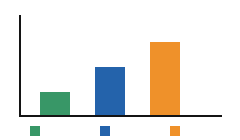

# A source based experiment {#opening}

The imaginary laboratory records three samples without using personal records. Each sample has a readable description and a value in its original written form. The identifier 0012 names a series, while −7 records a signed change. The decimal point in 123.45 remains part of the observation. A revision can correct a transcription only while retaining the original document and a reason for the change.

$E=mc^{2}$

# Included observations {#observations}

The second observation separates content from its position on the page. A sentence can occupy two lines without changing its words, but a missing line changes the result. Empty cells are present in the table and do not ask the reader to invent a measurement. The figure contains colored regions, axes and a legend. A matching filename cannot establish that those elements survived conversion.

$$\frac{x_i+1}{2}$$

$$\sum_{i=1}^{n}x_i$$

|      |       |        |
|:-----|:------|:-------|
| Code | Value | Note   |
| 0012 | 0     |        |
| B    | −7    | 123.45 |

: Measured cells

# Structured results {#results}

$$\begin{aligned}a&=1\\b&=-2\end{aligned}$$

$$\begin{bmatrix}0&-1\\2&3\end{bmatrix}$$

{#fig1}

See the figure and the source while keeping references explicit. [1](#fig1){reference-type="ref" reference="fig1"} [source](https://example.invalid/study?series=0012&mode=a_b#note) `\cite{bib1}`{=latex}

::: thebibliography
1 Synthetic Researcher. Source notebook, 2026.
:::
