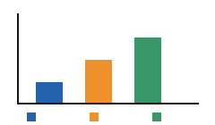

# Controllo completo {#start}

Caffè Cafè; spazio intenzionale; serie 0012; valore 123,45; cambio −7.

$$E=mc^2$$

| Codice | Valore | Nota |
|:---|---:|---|
|0012|−7||

: Misure del controllo



Ritorno [inizio](#start) [Fonte](https://example.invalid/check?x=0012&y=-7) Nota[^n1]

````python
if (x < 0) { print("$x_i$", "a_b", "−7"); }
````

[^n1]: Nota mantenuta: 0 e −7.

